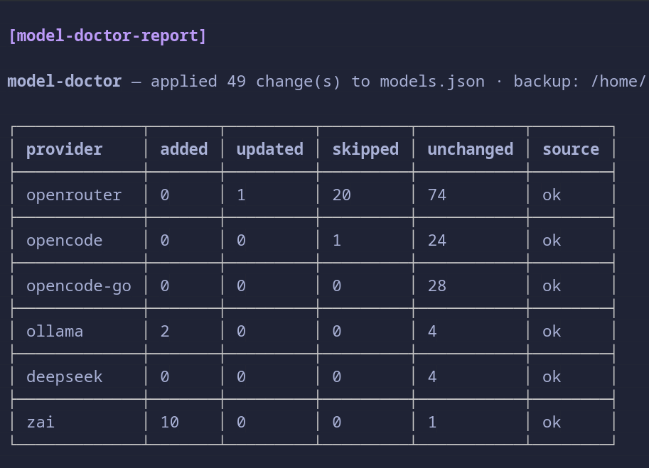

# pi-model-doctor

A [pi](https://github.com/earendil-works/pi-coding-agent) extension that adds a single command:

```
/model-doctor
```

One safe pass reconciles your model catalog into `~/.pi/agent/models.json` —
fetched from official sources, validated against pi's effective registry and
your config, written atomically with a timestamped backup, compare-and-swap and
rollback.

## What it syncs

**Dedicated providers** (hard-coded official rules):

- **OpenRouter** — public models list + per-model `/endpoints` limit confirmation; thinking levels cross-checked with Charm Hyper.
- **OpenCode** (Zen) and **OpenCode Go** — live catalogs are the authority for what is routable; models.dev only enriches intersecting ids; new ids are probed before they are added.

**Every other provider you configured** is synced *generically* over its own wire protocol:

| Protocol | `api` value(s) | Listing | Notes |
|---|---|---|---|
| OpenAI-compatible | `openai-completions`, `openai-responses` | `GET {base}/models` (or `/v1/models`) | Bearer key from models.json or auth.json |
| Anthropic | `anthropic-messages` | `GET {base}/v1/models` | `x-api-key` + `anthropic-version` |
| Gemini | `google-generative-ai` | `GET {base}/v1beta/models` | chat models only; context/output limits applied |

Generic rules:

- the live listing decides which model ids exist;
- ids Pi already serves from its own catalog are **never duplicated** into `models.json`;
- **genuinely new ids are added** with inherited transport (`api`, `baseUrl`) and any published metadata (Gemini limits, display names) — but only when the listing publishes **both** limits. A model whose context window or max output is unknown is skipped and reported instead of being written with a guess;
- existing entries are **never modified** and nothing is ever **removed**;
- providers not present in pi's effective registry are skipped.

## Install

```bash
pi install git:github.com/ZoRDoK/pi-model-doctor
```

Then run `/model-doctor` inside pi. The command takes no arguments.

## Report

A compact Markdown report lands in the chat transcript: a per-provider totals
table, an **Added** table (model · thinking · ctx / max out · input), an
**Updated** was → now table, and skipped models grouped by skip reason.

## No guessed limits

Every added entry carries a context window and a max output that the provider
actually published. The doctor never invents either: a model without confirmed
limits would silently run on Pi's tiny defaults, so it is reported as skipped
instead. For OpenRouter this means the per-model endpoints view must confirm the
limits; for OpenAI-compatible listings only explicit limit fields
(`context_length`/`context_window`, `max_completion_tokens`/`max_output_tokens`)
are trusted.

## Safety

- Only `models.json` is written (atomically, with backup + CAS + rollback); `settings.json`, `auth.json`, `models-store.json` are read-only.
- Every diff is re-verified against a strict allowlist before the write; a non-conforming diff refuses the whole apply.
- Secrets (api keys, OAuth tokens) are never logged, echoed, or copied into models.json; auth headers are attached only to the provider's own listing request.
- Unknown/extra fields, credentials, base URLs and headers of existing entries are preserved byte-for-byte.

## Code layout

| file | role |
|---|---|
| `src/index.ts` | pi entry: registry adapters + the single command handler |
| `src/doctor.ts` | diagnose → plan → reconcile → atomic apply |
| `src/sources.ts` | official catalog fetch/normalize + thinking-level resolution |
| `src/generic.ts` | wire-protocol sync for every other provider |
| `src/storage.ts` | atomic write, backups, hashing |
| `src/report.ts` | Markdown report + terminal-safe sanitizing |
| `src/paths.ts` | the only module that reads pi's env and paths |
| `src/types.ts`, `src/util.ts` | shared types and pure helpers |

## Development

```bash
npm install
npm test        # deterministic suite, temp dirs only, fully mocked network
npm run typecheck
```

CI runs the suite on Node 24 and 25 and scans the repo with gitleaks.

## License

MIT
